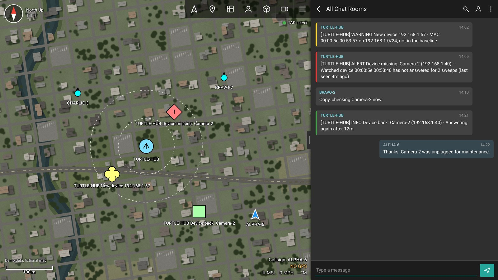
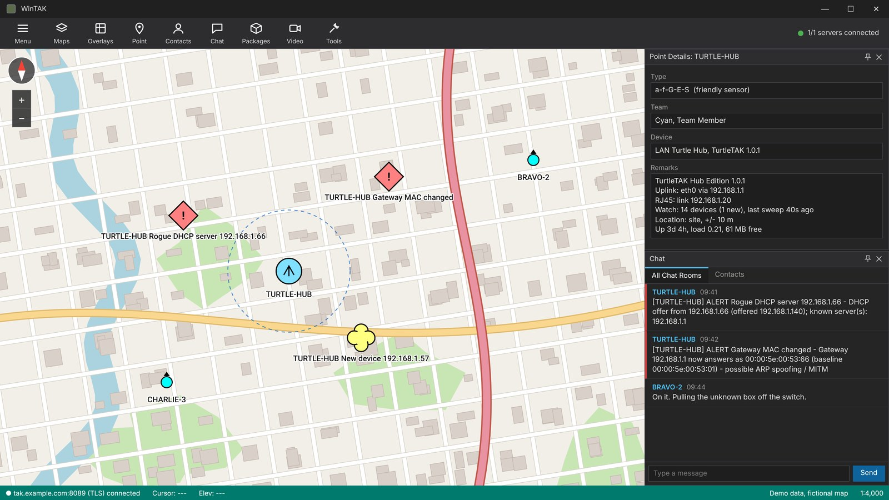

# TurtleTAK – TAK payloads for the Hak5 [LAN Turtle](https://hak5.org/products/lan-turtle-hub)

<p align="center"></p>

[](https://www.buymeacoffee.com/sect0101)

Community payloads that connect the **Hak5 LAN Turtle** family to the **TAK** ecosystem (ATAK, WinTAK, iTAK, WebTAK, CloudTAK) over Cursor-on-Target. The LAN Turtle becomes a sensor on the TAK map, watches the wired network, and raises TAK alerts.

**Payloads here are written in Bash + Python for the LAN Turtle Hub. They are community payloads and are not supported or guaranteed by Hak5.** See [Legal](#legal).

Also see [TurtleMesh](https://github.com/SECT0101/TurtleMesh) for Meshtastic on the same Hub, [PagerTAK](https://github.com/SECT0101/PagerTAK) for the WiFi Pineapple Pager and [SharkTAKDisplay](https://github.com/SECT0101/SharkTAKDisplay) for the Shark Jack Display.

---

## On the TAK map

<p align="center"> </p>

ATAK (left) and WinTAK (right): the Hub as a sensor marker, its alert markers around it and the same alerts in GeoChat. Mockups with demo data and a fictional map.

## Payloads

| Edition | Device | Version | Description |
|---|---|---|---|
| [TurtleTAK Hub Edition](payloads/library/general/TurtleTAK-Hub/) | LAN Turtle Hub | 1.0.1 | The Hub on TAK as a facility sensor: position and status reports and GeoChat; network watch alerts (new devices, watched devices going missing, ARP spoofing, rogue DHCP, link tamper, TAK link down and certificate expiry) with per-type settings and quiet hours; device names, site survey data packages and clone packages; an ATAK mesh SA bridge; TAK setup like ATAK (connection package, certificates with their own passwords, or enrollment) with no openssl needed; Wi-Fi and WireGuard uplinks; and a web console on port 8484 with an offline map. |

## Repository layout

```
payloads/
└── library/
    └── general/
        └── TurtleTAK-Hub/
            ├── payload.sh      # the whole payload: Bash for the Hub, with the Python service and web console inside
            └── README.md       # setup, features, alerts, location, LED, settings, files
docs/
├── logo.png                    # TurtleTAK Hub Edition
├── web-*.jpg                   # web console screenshots (demo data)
└── atak-hub.jpg, wintak-hub.jpg  # what TAK users see (mockups, demo data)
.github/
├── FUNDING.yml                 # Buy Me a Coffee (Sponsor button)
└── workflows/                  # shellcheck on every push; payload.sh attached to every release
```

Your settings, certificates and baselines live on the Hub under `/root/turtletak/`, outside the payload, so updating the payload never touches them.

## Requirements

- LAN Turtle Hub with Python 3 (no openssl needed)
- A TAK Server, plus a client certificate for TLS (or enroll on the Hub with a TAK username)
- Optional: `nmap` for faster sweeps with vendor names, and a USB GPS on the dynamic port

## Legal

Use these payloads only on networks you own or are explicitly authorized to monitor. You are responsible for complying with all applicable laws and policies. This project is not affiliated with or endorsed by Hak5 or the TAK Product Center.

## License

[GPL-3.0](LICENSE). Leaflet is bundled under BSD-2-Clause; see [THIRD-PARTY-LICENSES.txt](THIRD-PARTY-LICENSES.txt).
