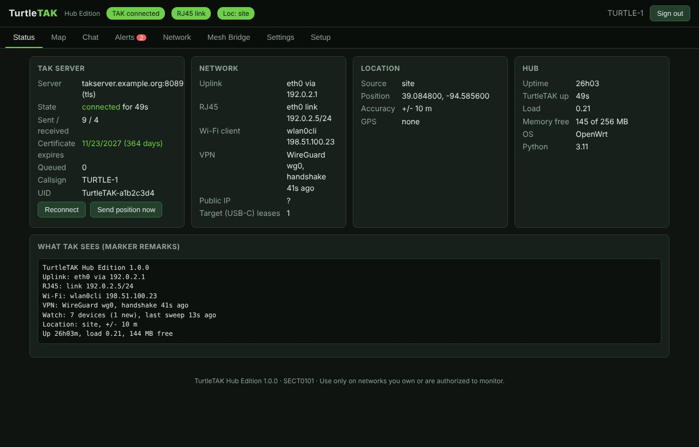
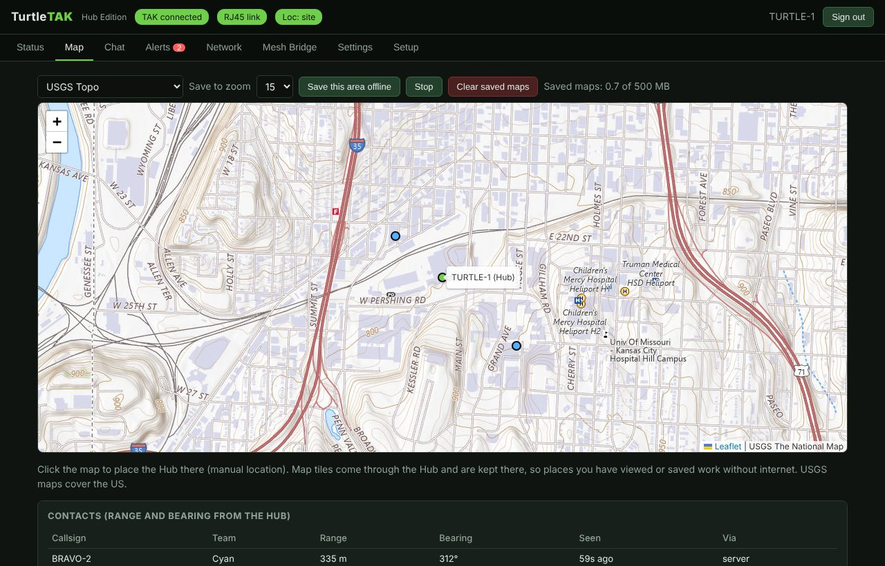
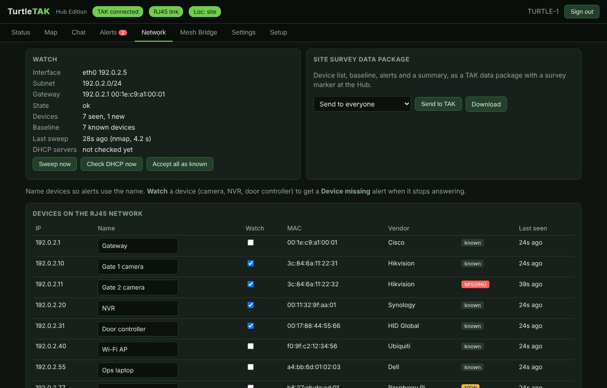
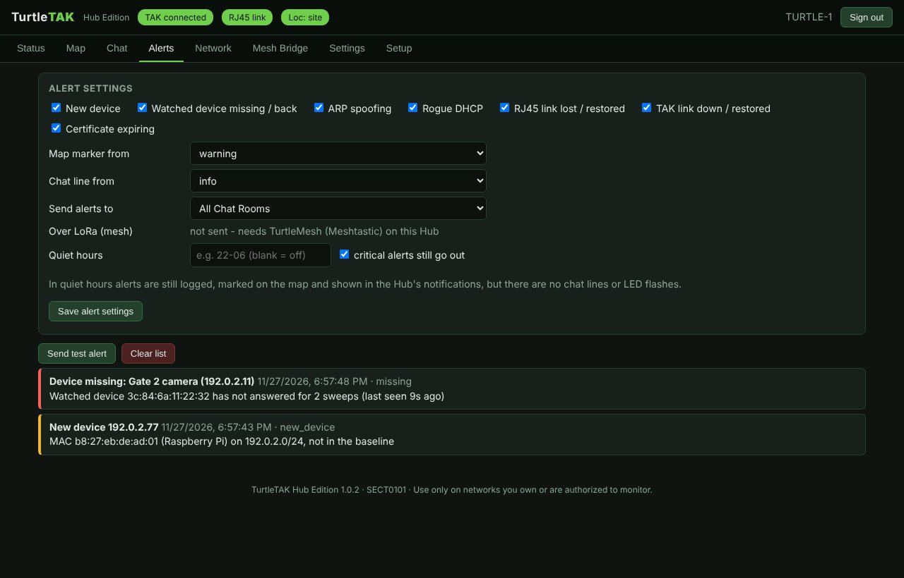
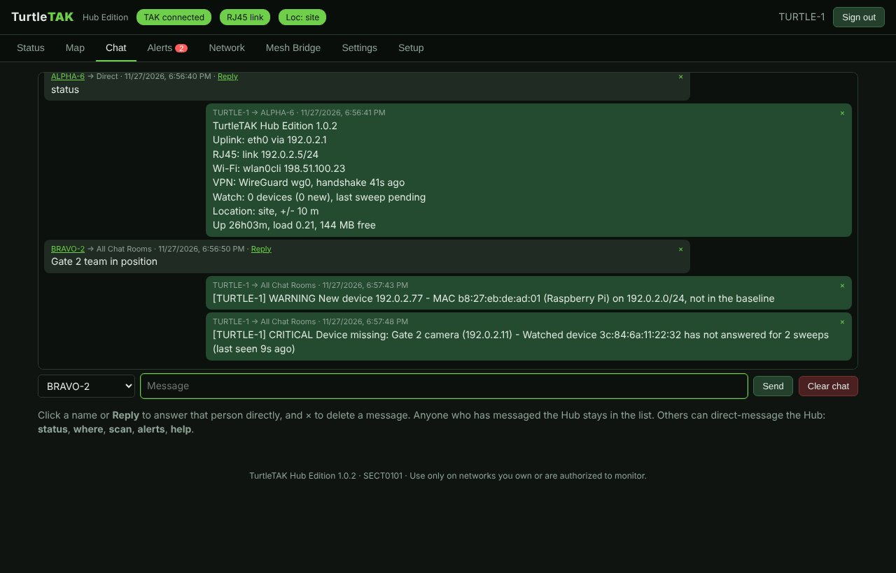
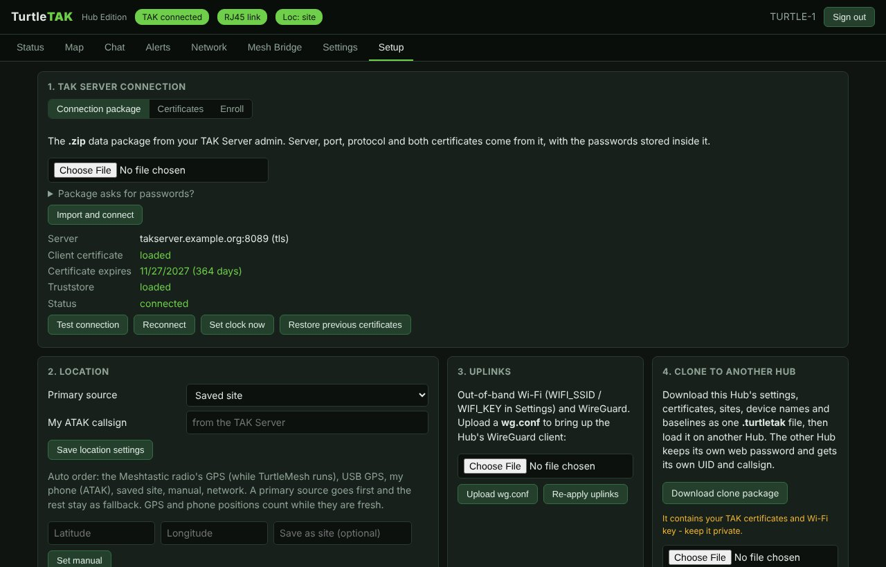

# TurtleTAK Hub Edition

Puts the **Hak5 LAN Turtle Hub** on **TAK** (ATAK, WinTAK, iTAK, WebTAK, CloudTAK) as a facility sensor.

Plug the Hub into a network and it shows up on the map as a sensor, with its status in the marker. It watches the wired network and raises TAK alerts when something changes. It can also put a room full of ATAK devices on your TAK Server.

> Use TurtleTAK only on networks you own or are authorized to monitor. It is a community payload and is not supported by Hak5.

## Features

| Feature | What it does |
|---|---|
| **Sensor on TAK** | Every `SA_INTERVAL` seconds (default 60), sends a CoT marker: a sensor (`a-f-G-E-S`) by default, or a facility, a team member in any of ATAK's 14 team colors, or a custom CoT type (Setup > On the TAK map). Its remarks show the uplink, RJ45 link and address, Wi-Fi client, VPN, public IP, watch and bridge counts, location source and Hub health. If reports stop, the marker goes stale, so a dead or unplugged Hub shows on the map. |
| **GeoChat** | Send to All Chat Rooms or one person from the web console, and read incoming chat, with an unread count on the Chat tab. Click a sender's name or **Reply** to answer them directly; anyone who has messaged the Hub stays in the list, CloudTAK users too. Delete one message, or clear the chat. Anyone can direct-message the Hub `status`, `where`, `scan`, `alerts` or `help` for a reply (`CHAT_COMMANDS_FROM` limits who). |
| **Network watch** | Sweeps the RJ45 network: nmap when installed, otherwise a ping sweep plus the ARP table. Each network gets its own baseline of known devices. |
| **Alerts** | **New device** (yellow). **Gateway MAC changed** or **one MAC claiming the gateway and another IP**, the ARP-spoofing / MITM signs (red). **Rogue DHCP server** (red). **RJ45 link lost / restored**, for a pulled cable or a switch port turned off. **TAK link down / restored**. |
| **Where alerts go** | A marker next to the Hub, a chat line such as `[TURTLE-1] CRITICAL Rogue DHCP server - ...` to All Chat Rooms (or one person, picked under *Send alerts to*), a Hub notification under the bell icon, optionally Cloud C² (`C2_NOTIFY`), and an LED flash. If TAK can't be reached, alerts and chat are **queued** and sent when it's back. |
| **Mesh SA bridge** | Off by default. Joins the ATAK mesh groups on the LAN (`239.2.3.1:6969` SA, `224.10.10.1:17012` chat) and forwards what it hears to the TAK Server. It understands both XML and TAK protocol v1 (protobuf). It can also repeat the server's traffic back onto the LAN, so phones on a closed network see everyone on the server and the server sees them. |
| **Uplinks** | Brings up the Hub's out-of-band Wi-Fi client (`WIFI_SSID`) and its WireGuard client (`wg.conf`) from the settings. Shows NetBird status if `netbird` is installed. |
| **Device names and watched devices** | Name devices in the Network tab ("Gate 2 camera") so alerts use the name. **Watch** the ones that must stay up (cameras, NVR, door controllers) and a **Device missing** alert (red) goes out when one stops answering for `MISSING_AFTER` sweeps, with **Device back** when it returns. |
| **Certificate expiry** | Shows when the client certificate expires (Status and Setup), and alerts `CERT_WARN_DAYS` (30) days before, and again if it has expired. |
| **Alert settings** | In the Alerts tab: turn each alert type on or off, choose the lowest level that gets a map marker and a chat line, and set quiet hours (for example `22-06`). In quiet hours there are no chat lines or LED flashes, but critical alerts can still go out. |
| **Site survey data package** | The device list (with names), baseline, recent alerts and a summary, as a TAK data package with a survey marker at the Hub. Send it to everyone or one contact, upload it to the server's data packages only, or download it. |
| **Clone to another Hub** | One `.turtletak` file holds settings, certificates, sites, device names and baselines. Load it on another Hub with a new callsign: that Hub keeps its own web password and gets its own UID. The file holds your certificates, so keep it private. |
| **Offline map** | The web map (Leaflet, built in) gets its tiles through the Hub and keeps them, on USB storage when one is attached. **Save this area offline** stores the current view down to zoom 16 (USGS Topo, Imagery or Imagery + Topo, US coverage). OpenStreetMap is offered live only, since its rules don't allow bulk saving. |
| **Web console** | Status, Map, Chat, Alerts, Network, Mesh Bridge, Settings and Setup on port **8484**, on every interface: USB-C host, RJ45, Wi-Fi and VPN. Password protected. Setup has *Test connection* and *Set clock now*. |

## Screenshots

Web console, with demo data.

| Status | Map |
|---|---|
|  |  |
| **Network** | **Alerts** |
|  |  |
| **Chat** | **Setup** |
|  |  |

## How the rogue DHCP check works

TurtleTAK sends one DHCPDISCOVER from a random, locally administered MAC with the broadcast flag set, then lists every server that answers. It never sends a request, so no lease is taken and the Hub's own address isn't touched. The first server seen is learned as the known one; set `DHCP_KNOWN` to list them yourself. Every `DHCP_INTERVAL` seconds (default 15 minutes).

## How baselines work

A baseline is keyed by subnet, gateway IP and gateway MAC, and saved in `/root/turtletak/baselines/`.

- **A new network**, or the same subnet at another site where only a few devices match, gets its own baseline on the first sweep (`AUTO_BASELINE`).
- **The same network with a different gateway MAC**, where most devices still match, keeps its baseline and raises *Gateway MAC changed*.
- **Accept all as known** (Network tab) adds everything seen to the baseline.

## Location

The Hub has no GPS. In `auto` mode TurtleTAK uses the first of these that works:

1. **Radio GPS**: the Meshtastic radio's own GPS fix, shared by [TurtleMesh](https://github.com/SECT0101/TurtleMesh) while it runs on the same Hub (or both run in TurtleShell), if it's newer than `RADIO_GPS_MAX_AGE` (30 minutes).
2. **USB GPS** on the dynamic USB port (the one nearest the USB-C cable). A u-blox / VK-162 style NMEA receiver works. TurtleTAK claims the port for the Hub (`GPS_CLAIM_USB`). When TurtleMesh uses a USB radio, TurtleTAK leaves that port alone.
3. **Anchor to my ATAK**: your phone's position from the TAK Server or the mesh (`MY_ATAK`), if it's newer than 30 minutes.
4. A **saved site** (`SITE`). Set one in Setup or by clicking the web map.
5. A **manual** lat/lon.
6. **Public IP** location, city level only. The marker gets a 25 km CE so TAK shows it's rough.

Pick a **primary source** in Setup > Location to put it first; the rest stay as fallback in the same order.

## Setup

1. Copy `payload.sh` to the Hub as its payload (web UI editor, `scp`, or USB) and run it.
2. The first run creates `/root/turtletak/` with `default.cfg` and `certs/README.txt`. It posts the web console's **first password** as a Hub notification and writes it to `/root/turtletak/web-password.txt`. Change it in Setup, then delete that file.
3. Open `http://172.16.84.1:8484` from the USB-C host, or the Hub's RJ45, Wi-Fi or VPN address, and sign in.
4. In **Setup > TAK Server connection**, pick one of three ways, the same as ATAK:
   - **Connection package**: the `.zip` from your TAK admin. The server, port, protocol and both certificates are imported, using the passwords stored in the package. If it asks, type the client and truststore passwords.
   - **Certificates**: the server address, port and protocol, then the **client certificate** (`.p12`) with **its password** and the **truststore** (`.p12`) with **its own password**. Both default to `atakatak`.
   - **Enroll**: your TAK username and password. The Hub makes its own key and gets a certificate from the server (port 8446).

   **No openssl needed.** TurtleTAK reads `.p12` files itself (modern AES, and older 3DES and RC2 ones) and makes enrollment keys in Python. You can also copy a `.zip`, `.p12` or `client.pem` / `ca.pem` into `/root/turtletak/certs/`.
5. Set the location, and turn on the mesh bridge if you want it.
6. *Run TurtleTAK at boot* is on by default (`BOOT_PAYLOAD enable`).

Running the payload again restarts the service with that version. The service and web page in `/root/turtletak/app/` are rewritten from `payload.sh` on every run, and your settings, certificates and baselines are kept.

## LED

| LED | Meaning |
|---|---|
| Magenta solid | Starting |
| Yellow double | Connecting to TAK |
| Green single | On TAK |
| Red slow | Setup needed: no server or certificate |
| Cyan inverse (60 s) | Warning alert |
| Red fast (60 s) | Critical alert |

Set `LED: 0` to keep the LED dark.

## Good to know

- **Hub firmware bugs** reported in the Hak5 Discord: the Management AP's channel can stay stuck after you change it, and a reboot from the Hub's web UI can hang the Hub. TurtleTAK never changes the Management AP or reboots the Hub. If you change those yourself, power-cycle the Hub if it doesn't come back.
- **Cloud C²**: from Cloud C² 3.5.2 the Hub role's permissions are off by default. Turn them on for the Hub in Cloud C² if you use `C2_NOTIFY`.
- **eMudhra root certificates** (October 2026): TurtleTAK checks your TAK Server only against the truststore you load, not the Hub's system certificate list, so the TAK link isn't affected. The system list is only used for the map tiles and the public IP lookup. Hak5 posted `remove-emudhra-certs.sh` in their Discord to remove the affected roots from Hak5 devices.

## Settings

Every setting is in `/root/turtletak/default.cfg` as `KEY: value`. Change them in the web console's **Settings** tab or over SSH. The most used ones are below, and [All settings](#all-settings) lists every key.

| Key | Default | |
|---|---|---|
| `CALLSIGN` | `TURTLE-1` | Name on the map |
| `COT_TYPE` / `TEAM` | `a-f-G-E-S` / `Cyan` | Marker type and team color (Setup > On the TAK map) |
| `SA_INTERVAL` | `60` | Seconds between reports |
| `LOC_MODE` | `auto` | Primary location source: `auto`, `radio`, `gps`, `atak`, `site`, `manual` or `ip` |
| `WATCH_INTERVAL` | `300` | Seconds between device sweeps |
| `WATCH_IFACE` | `auto` | RJ45 interface; auto-detected, shown in Setup check |
| `DHCP_KNOWN` | | Allowed DHCP servers (blank = learn the first) |
| `ALERT_TO` | | Blank = All Chat Rooms, or one callsign (Alerts > *Send alerts to*) |
| `BRIDGE_UP` / `BRIDGE_DOWN` | `0` / `0` | Mesh bridge directions |
| `WIFI_SSID` / `WIFI_KEY` | | Out-of-band Wi-Fi uplink |
| `WG_CONF` | | WireGuard config path (set by uploading `wg.conf`) |
| `CLIENT_PASSWORD` / `CA_PASSWORD` | `atakatak` | Client certificate and truststore passwords (set for you when you import) |
| `ALERTS_ON` | all types | Alert types that are raised |
| `MARKER_MIN_LEVEL` / `CHAT_MIN_LEVEL` | `warning` / `info` | Lowest level that gets a map marker / chat line |
| `QUIET_HOURS` | | For example `22-06` |
| `MISSING_AFTER` | `2` | Sweeps a watched device can miss before *Device missing* |
| `CERT_WARN_DAYS` | `30` | Days of warning before the certificate expires |
| `MAP_SOURCE` / `TILE_CACHE_MB` | `usgs_topo` / `500` | Web map and its tile cache limit |
| `WEB_PORT` | `8484` | Web console port (never 1471, the Hub's own UI) |

### All settings

Every key in `default.cfg`, in the order the file lists them. The Settings tab shows the same list.

| Key | Default | |
|---|---|---|
| **TAK Server** | | |
| `TAK_HOST` | `takserver.example.com` | TAK Server name or IP |
| `TAK_PROTO` | `tls` | `tls` (client certificate), `tcp`, or `udp` (send only) |
| `TAK_PORT` | `8089` | Streaming port (TLS 8089, TCP 8087 or 8088) |
| `TAK_VERIFY_HOST` | `0` | `1` = also check the server's name against its certificate |
| `CLIENT_PASSWORD` | `atakatak` | Client certificate (`.p12`) password |
| `CA_PASSWORD` | `atakatak` | Truststore (`.p12`) password, can differ from the client one |
| `API_PORT` | `8443` | Server API port: data package uploads, and the time for *Set clock now* |
| `ENROLL_PORT` | `8446` | Certificate enrollment port |
| `CALLSIGN` | `TURTLE-1` | Name on the map |
| `UID` | | Made once from the Hub; leave blank |
| `TEAM` | `Cyan` | Team color, one of ATAK's 14 (Setup > On the TAK map) |
| `ROLE` | `Team Member` | Role sent with the marker |
| `COT_TYPE` | `a-f-G-E-S` | Marker type: `a-f-G-E-S` sensor, `a-f-G-I` facility, `a-f-G-U-C` team member, or a custom CoT type |
| `SA_INTERVAL` | `60` | Seconds between reports |
| **Location** | | |
| `LOC_MODE` | `auto` | Primary source: `auto`, `radio`, `gps`, `atak`, `site`, `manual` or `ip`; the rest stay as fallback |
| `SITE` | | Saved site in use |
| `MANUAL_LAT` / `MANUAL_LON` | | Manual position |
| `MY_ATAK` | | Your ATAK callsign, for *Anchor to my ATAK* |
| `ANCHOR_MAX_AGE` | `1800` | Seconds your ATAK position stays usable |
| `RADIO_GPS_MAX_AGE` | `1800` | Seconds TurtleMesh's radio GPS fix stays usable |
| `GPS_DEVICE` | `auto` | `auto`, a port such as `/dev/ttyACM0`, or `off` |
| `GPS_BAUD` | `9600` | USB GPS speed |
| `GPS_CLAIM_USB` | `1` | Claim the dynamic USB port for the Hub (GPS or radio) |
| `IPGEO` | `1` | Allow the public IP location |
| `IPGEO_URL` | `https://ipinfo.io/json` | Where the public IP location comes from |
| **Network watch** | | |
| `WATCH` | `1` | Device sweeps on the RJ45 network |
| `WATCH_IFACE` | `auto` | RJ45 interface; auto-detected, shown in Setup check |
| `WATCH_INTERVAL` | `300` | Seconds between device sweeps |
| `WATCH_MAX_HOSTS` | `256` | Largest sweep (a /24); bigger subnets sweep the Hub's /24 |
| `WATCH_RATE` | `50` | nmap `--max-rate`, when nmap is installed |
| `AUTO_BASELINE` | `1` | The first sweep of a new network becomes its baseline |
| `ARP_WATCH` | `1` | Gateway MAC changes and duplicate MACs |
| `DHCP_WATCH` | `1` | Rogue DHCP server check |
| `DHCP_INTERVAL` | `900` | Seconds between DHCP checks |
| `DHCP_KNOWN` | | Allowed DHCP servers, comma list (blank = learn the first) |
| `LINK_WATCH` | `1` | RJ45 link lost / restored |
| `UPLINK_WATCH` | `1` | Alert when the TAK link is down longer than `UPLINK_GRACE` |
| `UPLINK_GRACE` | `120` | Seconds before *TAK link down* |
| `MISSING_AFTER` | `2` | Sweeps a watched device can miss before *Device missing* |
| **Alerts** | | |
| `ALERTS_ON` | all types | Alert types that are raised: `new_device`, `missing`, `arp`, `dhcp`, `link`, `uplink`, `cert` |
| `ALERT_MARKER` | `1` | Alert markers on the map |
| `MARKER_MIN_LEVEL` | `warning` | Lowest level that gets a map marker: `info`, `warning` or `critical` |
| `ALERT_CHAT` | `1` | Alert lines in chat |
| `CHAT_MIN_LEVEL` | `info` | Lowest level that gets a chat line |
| `QUIET_HOURS` | | For example `22-06`: no chat lines or LED flashes then (still logged and marked) |
| `QUIET_CRITICAL` | `1` | Critical alerts still go out in quiet hours |
| `CERT_WARN_DAYS` | `30` | Days of warning before the client certificate expires |
| `ALERT_TO` | | Blank = All Chat Rooms, or one callsign (Alerts > *Send alerts to*) |
| `ALERT_STALE_HOURS` | `12` | Hours an alert marker stays on the map |
| `HUB_NOTIFY` | `1` | Hub notifications (bell icon) |
| `C2_NOTIFY` | `0` | Cloud C² notifications too |
| **Mesh SA bridge** | | |
| `BRIDGE_UP` | `0` | Forward ATAK mesh SA and chat on the LAN to the TAK Server |
| `BRIDGE_DOWN` | `0` | Repeat TAK Server traffic onto the LAN mesh |
| `BRIDGE_IFACES` | `auto` | Every IPv4 interface except loopback and VPN, or a comma list |
| `BRIDGE_SA_GROUP` | `239.2.3.1:6969` | Mesh SA group |
| `BRIDGE_CHAT_GROUP` | `224.10.10.1:17012` | Mesh chat group |
| `BRIDGE_MIN_GAP` | `5` | Seconds between forwarded SA reports from one device |
| `BRIDGE_DOWN_TYPES` | `a-f,a-h,a-n,a-u,b-t-f,b-m` | CoT types repeated onto the LAN |
| **Map** | | |
| `MAP_SOURCE` | `usgs_topo` | `usgs_topo`, `usgs_imagery`, `usgs_hybrid` or `osm` (live only, never saved in bulk) |
| `TILE_CACHE_MB` | `500` | Map tile cache limit (on USB storage when one is attached) |
| `TILE_MAX_DOWNLOAD` | `20000` | Most tiles one *Save this area offline* may fetch |
| **Uplinks** | | |
| `WIFI_SSID` / `WIFI_KEY` | | Out-of-band Wi-Fi uplink (the Hub joins this network as a client) |
| `WIFI_ENC` | `psk2` | `open`, `psk`, `psk2` or `sae` |
| `WIFI_COUNTRY` | `US` | Wi-Fi country code |
| `WG_CONF` | | WireGuard config path (set by uploading `wg.conf`) |
| **Hub** | | |
| `LED` | `1` | `0` = keep the LED dark |
| `RUN_AT_BOOT` | `1` | Start TurtleTAK when the Hub boots |
| `CHAT_COMMANDS` | `1` | Answer `status`, `where`, `scan`, `alerts` and `help` sent to the Hub |
| `CHAT_COMMANDS_FROM` | | Blank = anyone on the server, or a comma list of callsigns |
| `CLOCK_SYNC` | `1` | *Set clock now* may set the Hub's clock (from the TAK Server, the web, then NTP) |
| `WEB` | `1` | Web console on |
| `WEB_PORT` | `8484` | Web console port (never 1471, the Hub's own UI) |
| `WEB_BIND` | `0.0.0.0` | Every interface: USB-C host, RJ45, Wi-Fi and VPN |
| `WEB_TLS` | `0` | `1` = HTTPS with a self-signed certificate (needs `openssl`) |
| `WEB_PASS_HASH` | | Web console password, set with *Change password* |

## Files

| Path | |
|---|---|
| `/root/turtletak/default.cfg` | Settings |
| `/root/turtletak/certs/` | TAK certificates, connection packages, `wg.conf`. Never share them. |
| `/root/turtletak/baselines/` | Known devices, one file per network |
| `/root/turtletak/sites.txt` | Saved sites: `name\|lat\|lon` |
| `/root/turtletak/devices.json` | Device names and watched devices |
| `/root/turtletak/tiles/` | Saved map tiles (`/usb/turtletak-tiles/` when USB storage is attached) |
| `/root/loot/turtletak/` | Site survey data packages |
| `/root/turtletak/logs/` | `turtletak.log` (also in the web console) and `console.log` |
| `/root/turtletak/app/` | The service and web page, rewritten on every run |

## Credits

The web map uses [Leaflet](https://leafletjs.com) (BSD-2-Clause), bundled in the payload. USGS map tiles are from The National Map.

## Requirements

- LAN Turtle Hub with Python 3. The Hub runs Bash and Python payloads.
- Optional: `nmap` for faster sweeps with vendor names, and `wg` for the VPN status line. `openssl` is **not** needed.
- A network path to your TAK Server: RJ45, the Hub's Wi-Fi client, or a VPN.
